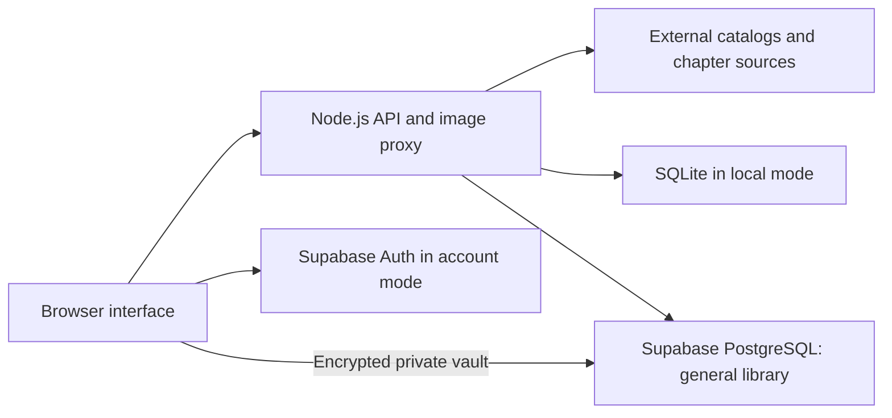

# Lector Manga

**A browser-based manga and manhwa library with multiple sources, reading progress and cross-device synchronization.**

**English** · [Español](README.es.md) · [Open the web app](https://hanyer001.github.io/lector_manga/)

Organize stories, explore catalogs and read in continuous vertical or paginated mode. Run the application locally with SQLite, or deploy the frontend and API with Supabase accounts for synchronization between desktop and mobile browsers.

**Deployment note:** GitHub Pages hosts the interface. Reading and source queries require the Node.js API; publishing the HTML alone does not provide a working reader. External account registration also requires a configured SMTP service in Supabase. The public URL is an entry point, not a guarantee that every source or account flow is available.

## Features

- Visual library with covers, folders, genres, authors and personal reading states.
- Search across source catalogs, add stories by URL and refresh chapter lists.
- Preview stories and try a chapter without adding it to the library.
- Link editions from different sources while keeping their chapters and reading positions separate.
- Continuous and paginated reading, right-to-left direction, zoom, width, brightness and warm-color controls.
- Recommendations based on preferences, recent reading, similar stories, genres or variety, with explanations and exclusions.
- Track the last confirmed save, retry failed progress updates and resume across screen sizes using a page-and-fraction anchor.
- Export and import library metadata and progress.
- Private library with browser-side encryption in account mode, plus a separate local PIN mode.
- Responsive navigation, dark/OLED/light/system themes and configurable accents.

The user interface is currently in Spanish. This README documents the project in English.

## Quick start

Requires **Node.js 22.19+** and npm. Deployment configuration uses Node.js 24.

```sh
git clone https://github.com/Hanyer001/lector_manga.git
cd lector_manga
npm ci
npm run server
```

Open [http://127.0.0.1:3210/](http://127.0.0.1:3210/). Stop with `Ctrl+C`.

The default mode runs locally without an external account. `npm run server` also prepares generated client resources. **`npm start` launches the scraper CLI**, rather than the web application.

Optional `.env` settings, based on [.env.example](.env.example):

```dotenv
APP_MODE=local
PORT=3210
# DB_PATH=/absolute/path/to/reader.db
```

The local server binds to loopback. To access the application from another device, follow the HTTPS [deployment guide (Spanish)](DEPLOYMENT.md).

## Try the reader without external sources

After installing dependencies:

```sh
npm run demo:reader
```

Open [http://127.0.0.1:3211/?chapter=1](http://127.0.0.1:3211/?chapter=1). This isolated demo uses an in-memory database and synthetic image fixtures, without changing your personal library.

## Architecture



| Component | Responsibility |
| --- | --- |
| `src/frontend/` | Library, discovery, reader, local device state and private vault UI. |
| `src/backend/` | API, account context, synchronization, privacy and streaming image proxy. |
| `src/core/` | Scraper contracts, operation budgets, cancellation and errors. |
| `src/extensions/` | Source adapters, capabilities, allowed origins and shared catalog. |
| `src/storage/` | SQLite schema, migrations, metadata and import/export. |
| `src/transports/` | HTTP/JSON transport and optional browser transport. |
| `supabase/migrations/` | PostgreSQL account and encrypted vault migrations. |

Source adapters are loaded on demand. Network operations share bounded deadlines, cancellation and source-specific concurrency limits. The image proxy streams responses with backpressure; the reader loads a limited window of images around the current position.

## Storage and privacy

| Mode | General library | Private library |
| --- | --- | --- |
| Local server | SQLite at `data/reader.db` by default | PIN-gated metadata in SQLite; the database is not encrypted. |
| Deployed guest | IndexedDB in that browser and device | Password-encrypted device vault. |
| Account | Per-user state in Supabase PostgreSQL | Encrypted in the browser before synchronization. |

Chapter content is stored as **links and metadata, not downloaded image files**. Images are streamed and temporarily held by the browser. There is no complete offline chapter archive; reading depends on the source remaining available.

Account storage allows 12 MiB of general library metadata and another 12 MiB for the private vault. Browser appearance preferences stay on the device. Guest data can be lost when site storage is cleared, so export a backup when needed.

General progress updates can retain a local retry queue. Pending private updates remain in memory and can be lost if the page closes before synchronization. Keep the vault open until the save is confirmed. Local exports containing private readings are readable; account private exports preserve encryption. Keep backups outside Git.

See the [Spanish guide](README.es.md) for vault recovery, imports, device-to-account migration and synchronization behavior, and [SECURITY.md](SECURITY.md) for security details.

## Development

| Command | Purpose |
| --- | --- |
| `npm run server` | Local API and web interface. |
| `npm test` | API, storage, discovery, scraper and privacy tests. |
| `npm run test:ui` | Playwright browser tests, including an iPhone-style WebKit profile. |
| `npm run build:pages` | Static frontend with public deployment settings. |
| `npm run build:render` | Backend client assets and optional browser setup. |
| `npm run demo` | Scraper example using local fixtures. |
| `npm run demo:reader` | Isolated reader demo on port 3211. |

For UI checks, install the browser engines first:

```sh
npx playwright install chromium webkit
npm run test:ui
```

Tests use fixtures and temporary databases. PostgreSQL migration checks use PGlite. A mobile WebKit profile complements testing on a real iPhone; it does not replace it.

## Deployment and source availability

The deployment separates GitHub Pages, a Render Node.js API and Supabase Auth/PostgreSQL. Follow [DEPLOYMENT.md (Spanish)](DEPLOYMENT.md) for environment variables, HTTPS, authorized origins, migrations and SMTP setup.

Providers expose different capabilities. Some return only catalog metadata; others provide chapters. Availability can differ between local execution and hosted infrastructure. A source listed in the code is not necessarily enabled in the public catalog. Consult the [source guide (Spanish)](src/extensions/README.md) and runtime diagnostics.

## Documentation

- [Spanish user guide](README.es.md)
- [Deployment](DEPLOYMENT.md) and [security](SECURITY.md)
- Technical guides in Spanish: [API](src/backend/README.md), [sources](src/extensions/README.md), [storage](src/storage/README.md), [reader](src/frontend/README.md), [transports](src/transports/README.md)

To add a source, implement an adapter and register its identity, origins, capabilities and loader in `src/extensions/catalog.js`. Preserve the engine's URL validation and operation limits. Report bugs with reproduction steps in [Issues](https://github.com/Hanyer001/lector_manga/issues), without credentials or personal library exports.
